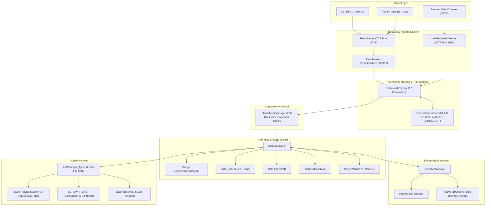

# MiniRedis: High-Performance Redis-Compatible In-Memory Database in Java

[](https://openjdk.org/)
[](LICENSE)
[]()
[]()
[]()

**MiniRedis** is a production-grade, Redis-compatible in-memory database server engineered from first principles in **pure Java 17** with **zero external runtime dependencies**.

It implements 57 Redis commands, full RESP2 wire protocol serialization, 256-stripe deadlock-free concurrent locking, millisecond-precision dual-model expiration, Write-Ahead Append-Only File (AOF) persistence with background compaction (`BGREWRITEAOF`), optimistic CAS transactions (`WATCH`/`MULTI`/`EXEC`), live telemetry, an interactive CLI, and an embedded Web Console GUI.

---

## Architecture

MiniRedis is designed around clean architectural layering, strict isolation, and deterministic concurrency control:



---

## Core Features

- **Pure Java 17 Standard Library**: Requires only `java.base` and `jdk.httpserver`. Zero external runtime libraries (no Netty, Spring, Jackson, or Jedis on runtime classpath).
- **57 Supported Commands**: Complete coverage of key-value operations, data structures, expirations, transactions, and server management.
- **RESP2 Protocol Engine**: Full support for simple strings (`+`), errors (`-`), integers (`:`), bulk strings (`$`), null bulk strings (`$-1\r\n`), empty bulk strings (`$0\r\n\r\n`), and arrays (`*`). Supports command pipelining.
- **256-Stripe Concurrency**: High-throughput read-write lock striping with canonical ascending lock ordering, guaranteeing zero multi-key deadlocks.
- **Linearizable Read Snapshots**: Deep copies taken under read locks prevent torn reads during concurrent multi-key queries (`MGET`).
- **Zero Orphaned Collections**: Atomic `ConcurrentHashMap.compute()` semantics delete collection keys immediately when empty.
- **Precision Expiration**: Sub-millisecond TTL tracking via dual eviction (lazy on-access check + 100ms background sweep with probabilistic termination).
- **AOF Persistence & Auto-Recovery**: WAL engine with `ALWAYS`, `EVERYSEC`, and `NO` fsync policies. Converts relative TTLs to absolute timestamps (`PEXPIREAT`), features non-blocking `BGREWRITEAOF` compaction with diff buffering, and automatically truncates corrupt trailing transactions on crash recovery.
- **Optimistic CAS Transactions**: Full `MULTI`/`EXEC`/`DISCARD`/`WATCH`/`UNWATCH` support with compile-time syntax tracking (`EXECABORT`) and CAS key versioning.
- **Dual Server Interfaces**: TCP server on port 6379 + Embedded HTTP Web Console on port 8080.
- **Client Compatibility**: Connects seamlessly with standard tools (`redis-cli`, Python `redis-py` with `protocol=2`, Java Jedis / Lettuce).

---

## Supported Redis Commands (57 Commands)

### 1. Key-Value & Server Control
| Command | Syntax | Description | Example |
| :--- | :--- | :--- | :--- |
| `SET` | `SET key value` | Stores string value and clears existing TTL | `SET user:1 "Alice"` |
| `GET` | `GET key` | Retrieves string value | `GET user:1` |
| `DEL` | `DEL key [key ...]` | Deletes one or more keys | `DEL user:1 user:2` |
| `EXISTS` | `EXISTS key [key ...]` | Returns count of existing keys | `EXISTS user:1` |
| `KEYS` | `KEYS pattern` | Returns keys matching glob pattern (`*`, `?`, `[abc]`) | `KEYS user:*` |
| `DBSIZE` | `DBSIZE` | Returns total number of active keys | `DBSIZE` |
| `FLUSHDB` | `FLUSHDB` | Purges all keys from memory | `FLUSHDB` |

### 2. Advanced Strings & Numeric Operations
| Command | Syntax | Description | Example |
| :--- | :--- | :--- | :--- |
| `MSET` | `MSET k1 v1 [k2 v2 ...]` | Atomically sets multiple keys | `MSET a 1 b 2 c 3` |
| `MGET` | `MGET k1 [k2 ...]` | Linearizable multi-key read | `MGET a b c missing` |
| `INCR` | `INCR key` | Increments 64-bit integer by 1 | `INCR counter` |
| `DECR` | `DECR key` | Decrements 64-bit integer by 1 | `DECR counter` |
| `INCRBY` | `INCRBY key delta` | Increments 64-bit integer by specified delta | `INCRBY score 25` |
| `DECRBY` | `DECRBY key delta` | Decrements 64-bit integer by specified delta | `DECRBY score 10` |
| `APPEND` | `APPEND key value` | Appends value to existing string | `APPEND msg " World"` |
| `STRLEN` | `STRLEN key` | Returns byte length of string value | `STRLEN msg` |

### 3. Lists (Double-Ended Queues)
| Command | Syntax | Description | Example |
| :--- | :--- | :--- | :--- |
| `LPUSH` | `LPUSH key elem [elem ...]` | Prepends elements to head | `LPUSH jobs job1 job2` |
| `RPUSH` | `RPUSH key elem [elem ...]` | Appends elements to tail | `RPUSH jobs job3` |
| `LPOP` | `LPOP key` | Pops element from head | `LPOP jobs` |
| `RPOP` | `RPOP key` | Pops element from tail | `RPOP jobs` |
| `LLEN` | `LLEN key` | Returns number of elements | `LLEN jobs` |
| `LRANGE` | `LRANGE key start stop` | Retrieves range (supports negative indices `0 -1`) | `LRANGE jobs 0 -1` |

### 4. Sets (Unique Unordered Collections)
| Command | Syntax | Description | Example |
| :--- | :--- | :--- | :--- |
| `SADD` | `SADD key member [member ...]` | Adds unique members to set | `SADD tags nosql redis java` |
| `SREM` | `SREM key member [member ...]` | Removes members from set | `SREM tags redis` |
| `SISMEMBER` | `SISMEMBER key member` | Returns 1 if member exists, 0 otherwise | `SISMEMBER tags java` |
| `SMEMBERS` | `SMEMBERS key` | Returns all members in set | `SMEMBERS tags` |
| `SCARD` | `SCARD key` | Returns cardinality of set | `SCARD tags` |

### 5. Hashes (Field-Value Dictionaries)
| Command | Syntax | Description | Example |
| :--- | :--- | :--- | :--- |
| `HSET` | `HSET key field val [field val...]` | Sets field-value pairs in hash | `HSET user:1 name "Alice" age 30` |
| `HGET` | `HGET key field` | Retrieves value for field | `HGET user:1 name` |
| `HGETALL` | `HGETALL key` | Returns interleaved array of all fields & values | `HGETALL user:1` |
| `HDEL` | `HDEL key field [field ...]` | Deletes fields from hash | `HDEL user:1 age` |
| `HEXISTS` | `HEXISTS key field` | Returns 1 if field exists, 0 otherwise | `HEXISTS user:1 name` |

### 6. Key Expiration & TTL Management
| Command | Syntax | Description | Example |
| :--- | :--- | :--- | :--- |
| `EXPIRE` | `EXPIRE key seconds` | Sets expiration in seconds | `EXPIRE session:abc 3600` |
| `PEXPIRE` | `PEXPIRE key milliseconds` | Sets expiration in milliseconds | `PEXPIRE token 5000` |
| `PEXPIREAT` | `PEXPIREAT key epochMillis` | Sets absolute expiration timestamp (unix epoch) | `PEXPIREAT token 1893456000000` |
| `TTL` | `TTL key` | Returns TTL in seconds (`-1` persistent, `-2` missing) | `TTL session:abc` |
| `PTTL` | `PTTL key` | Returns TTL in milliseconds | `PTTL token` |
| `PERSIST` | `PERSIST key` | Removes expiration, converting key to persistent | `PERSIST session:abc` |
| `SETEX` | `SETEX key seconds value` | Sets key and expiration atomically | `SETEX token 60 "secret"` |

### 7. Optimistic CAS Transactions
| Command | Syntax | Description | Example |
| :--- | :--- | :--- | :--- |
| `WATCH` | `WATCH key [key ...]` | Monitors keys for optimistic concurrent mutations | `WATCH account:A account:B` |
| `UNWATCH` | `UNWATCH` | Discards all watched keys on connection | `UNWATCH` |
| `MULTI` | `MULTI` | Begins transactional queuing block | `MULTI` |
| `EXEC` | `EXEC` | Executes queued commands atomically in canonical lock order | `EXEC` |
| `DISCARD` | `DISCARD` | Discards queued commands and exits transaction block | `DISCARD` |

### 8. System, Telemetry, Persistence & Compatibility
| Command | Syntax | Description | Example |
| :--- | :--- | :--- | :--- |
| `PING` | `PING [message]` | Tests connectivity (`PONG` or echo message) | `PING` |
| `ECHO` | `ECHO message` | Returns message back to client | `ECHO "hello"` |
| `TYPE` | `TYPE key` | Returns data type (`string`, `list`, `set`, `hash`, `none`) | `TYPE user:1` |
| `RENAME` | `RENAME key newkey` | Renames key preserving value and TTL | `RENAME old new` |
| `RANDOMKEY`| `RANDOMKEY` | Returns a random key from database | `RANDOMKEY` |
| `SAVE` | `SAVE` | Synchronously flushes AOF log to disk | `SAVE` |
| `SHUTDOWN` | `SHUTDOWN [NOSAVE\|SAVE]` | Gracefully closes connections, persists state, stops server | `SHUTDOWN SAVE` |
| `BGREWRITEAOF`| `BGREWRITEAOF` | Starts background AOF compaction | `BGREWRITEAOF` |
| `HELLO` | `HELLO [proto]` | Protocol handshake returning server metadata | `HELLO 2` |
| `SELECT` | `SELECT index` | Logical database selector (database 0 supported) | `SELECT 0` |
| `CLIENT` | `CLIENT SETNAME\|LIST` | Client connection inspection & management | `CLIENT LIST` |
| `AUTH` | `AUTH [user] password` | Compatibility authentication stub | `AUTH default secret` |
| `INFO` | `INFO [section]` | Server, clients, memory, persistence, stats, keyspace metrics | `INFO stats` |
| `COMMAND` | `COMMAND [DOCS\|COUNT]` | Redis CLI compatibility command catalog | `COMMAND` |

---

## Installation & Build Instructions

### Prerequisites
- **Java Development Kit**: JDK 17 or higher (tested with Eclipse Temurin and Oracle OpenJDK).
- **Apache Maven**: Version 3.8 or higher.

### 1. Build and Run the Complete Test Suite
```bash
mvn clean test
```
*Current test suite: **145 tests run, 0 failures, 0 errors, 0 skipped** across all 16 test suites.*

### 2. Package Executable JAR
```bash
mvn clean package
```
Generates the runnable artifact at `target/miniredis-java-1.0.0.jar`.

### 3. Launch MiniRedis Server
```bash
java -jar target/miniredis-java-1.0.0.jar
```
Upon startup, MiniRedis automatically initializes:
1. **TCP RESP2 Server** on `0.0.0.0:6379`.
2. **HTTP Web Console** on `http://localhost:8080`.
3. **Local CLI REPL** on stdin (`miniredis> `).

---

## Client Usage

### 1. Interactive Command Line Interface (CLI)
You can enter commands directly into the terminal where MiniRedis was launched:
```text
miniredis> SET user:100 "Alice"
+OK
miniredis> EXPIRE user:100 60
:1
miniredis> TTL user:100
:58
miniredis> HSET profile:100 name "Alice" role "Engineer"
:2
miniredis> HGETALL profile:100
1) name
2) Alice
3) role
4) Engineer
```

### 2. Built-In Java Client
MiniRedis includes a built-in interactive TCP CLI client:
```bash
java -cp target/miniredis-java-1.0.0.jar com.miniredis.client.RedisClient 127.0.0.1 6379
```

### 3. Official `redis-cli`
Connect using standard `redis-cli`:
```bash
redis-cli -h 127.0.0.1 -p 6379
```

---

## Embedded Web Console (`http://localhost:8080`)

MiniRedis includes an embedded HTTP web server built using `jdk.httpserver` (zero external dependencies).

### Features:
- **Live Server Telemetry Cards**: Uptime, total memory usage, peak operations per second, connected TCP clients, and keyspace hits/misses.
- **Visual Keyspace Browser**: Inspect all keys currently stored in RAM, filter by pattern, and inspect data types with color-coded badges (`STRING`, `LIST`, `SET`, `HASH`). Displays live TTL countdowns for expiring keys.
- **Interactive Terminal REPL**: Send commands directly from your browser with full command history navigation (Up/Down arrows) and clear results formatting.

To access the Web Console, open [http://localhost:8080](http://localhost:8080) in any modern browser.

---

## AOF Persistence Architecture

MiniRedis provides crash resilience via its Append-Only File (AOF) subsystem:

1. **Write-Ahead Logging**: Every mutating command is serialized in RESP2 format and written to `appendonly.aof`.
2. **Configurable Fsync Policies**:
   - `ALWAYS`: Synchronous `fsync()` on every single write. Maximum durability.
   - `EVERYSEC`: Writes are flushed to the OS page cache immediately; a background daemon thread executes `fsync()` every 1000ms. Balances durability with high throughput.
   - `NO`: Leaves flushing entirely to the host OS kernel.
3. **Absolute Expiration Normalization**: When writing expiring keys to AOF, relative TTL commands (`EXPIRE key 60`) are automatically converted into absolute epoch timestamps (`PEXPIREAT key <timestamp>`). This ensures keys do not gain unintended lifetime extensions when replayed upon server restart.
4. **Non-Blocking Background Compaction (`BGREWRITEAOF`)**: Consolidates state by writing only the latest live keys to a temporary file. A thread-safe diff buffer captures mutations occurring during the rewrite. Upon completion, the diff buffer is flushed and the temporary file replaces the main AOF file.
5. **Crash Recovery & Auto-Truncation**: On boot, `AofManager` replays the AOF log. If the server crashed mid-write, MiniRedis automatically detects incomplete or corrupted trailing frames, safely truncates them, and logs recovery status without aborting startup.

---

## Transaction Architecture (`MULTI` / `EXEC` / `WATCH`)

MiniRedis implements full Redis transactional semantics:

1. **Command Queuing**: After `MULTI`, commands are validated and queued inside `TransactionContext` rather than executed immediately. The server replies with `+QUEUED\r\n`.
2. **Compile-Time Error Handling (`EXECABORT`)**: If an unrecognized command or syntax error occurs while queuing, the transaction is marked as aborted. When `EXEC` is subsequently called, it fails immediately with `-EXECABORT Transaction discarded because of previous errors.\r\n`.
3. **Optimistic CAS Locking (`WATCH`)**: When a client watches one or more keys, MiniRedis records the keys' mutation counter versions. If an external client modifies, deletes, or expires any watched key before `EXEC`, the transaction aborts and `EXEC` returns a null array (`*-1\r\n`).
4. **Deadlock-Free Atomic Execution**: During `EXEC`, MiniRedis identifies all keys referenced in the transaction, maps them to lock stripes, sorts the stripe indices in ascending canonical order (`0 -> 1 -> ... -> 255`), and acquires write locks. This guarantees atomicity and absolute isolation across concurrent TCP clients with zero possibility of circular wait deadlocks.

---

## Python `redis-py` Integration

MiniRedis is fully compatible with the official Python `redis-py` library.

> [!NOTE]
> Since MiniRedis implements RESP2, configure `redis-py` 8.x with `protocol=2`:

```python
import redis

# Connect using RESP2 protocol
r = redis.Redis(host='127.0.0.1', port=6379, protocol=2, decode_responses=True)

# 1. Basic Key-Value
r.set('user:name', 'Krishna')
print(r.get('user:name'))  # Output: Krishna

# 2. Lists & Hashes
r.rpush('tasks', 'task1', 'task2')
r.hset('profile', mapping={'role': 'engineer', 'lang': 'java'})
print(r.hgetall('profile'))  # {'role': 'engineer', 'lang': 'java'}

# 3. Optimistic Transactions with WATCH
with r.pipeline() as pipe:
    pipe.watch('account:balance')
    balance = int(pipe.get('account:balance') or 100)
    pipe.multi()
    pipe.set('account:balance', str(balance + 50))
    pipe.execute()

# 4. Telemetry
stats = r.info('stats')
print(f"Total commands processed: {stats['total_commands_processed']}")
```

---

## Empirical Benchmark Results

*Measured on Windows 11 (amd64, 8 Logical Cores, OpenJDK 64-Bit, 1.5 GB Heap).*

### 1. In-Process Engine Dispatch Benchmark (40,000 ops/run)
Evaluates raw storage engine throughput and 256-stripe locking efficiency under concurrent threads:

| Workload | Client Threads | Throughput | Avg Latency | P95 Latency | P99 Latency |
| :--- | :--- | :--- | :--- | :--- | :--- |
| **GET only** | 1 | 543,391 op/s | 1.53 μs | 1.50 μs | 2.50 μs |
| **GET only** | 10 | 716,222 op/s | 5.85 μs | 1.40 μs | 3.70 μs |
| **GET only** | 25 | **1,423,649 op/s** | **0.93 μs** | **0.60 μs** | **1.20 μs** |
| **GET only** | 50 | **1,479,629 op/s** | **0.44 μs** | **0.40 μs** | **1.00 μs** |
| **SET only** | 1 | 213,649 op/s | 3.67 μs | 4.10 μs | 20.50 μs |
| **SET only** | 10 | 312,435 op/s | 21.63 μs | 3.40 μs | 18.20 μs |
| **SET only** | 25 | 407,436 op/s | 1.79 μs | 1.60 μs | 2.80 μs |
| **SET only** | 50 | **822,831 op/s** | **10.07 μs** | **1.20 μs** | **3.00 μs** |
| **Mixed (50% G / 30% S / 10% I / 10% L)** | 10 | 488,802 op/s | 14.57 μs | 5.10 μs | 15.00 μs |
| **Mixed (50% G / 30% S / 10% I / 10% L)** | 50 | 376,639 op/s | 51.51 μs | 2.80 μs | 12.20 μs |

### 2. Live TCP + RESP2 Persistent Sockets Benchmark (12,000 reqs/run)
Evaluates end-to-end TCP socket I/O, UTF-8 framing, RESP2 serialization, and multi-client connection handling:

| Workload | Concurrent Sockets | Throughput | Avg Latency | P95 Latency | P99 Latency | Failed Ops |
| :--- | :--- | :--- | :--- | :--- | :--- | :--- |
| **GET only** | 25 | **68,670 op/s** | 172.83 μs | 229.70 μs | 647.90 μs | 0 |
| **GET only** | 50 | 50,163 op/s | 257.10 μs | 221.40 μs | 559.00 μs | 0 |
| **SET only** | 10 | **66,622 op/s** | 147.92 μs | 171.50 μs | 409.30 μs | 0 |
| **SET only** | 50 | 50,235 op/s | 194.87 μs | 214.80 μs | 693.00 μs | 0 |
| **Mixed R/W** | 10 | **58,456 op/s** | 166.31 μs | 172.10 μs | 436.80 μs | 0 |
| **Mixed R/W** | 50 | 57,205 op/s | 140.03 μs | 187.00 μs | 458.50 μs | 0 |
| **MULTI/INCRBY/EXEC** | 25 | **38,965 tx/s** | 377.59 μs | 293.50 μs | 1,879.40 μs | 0 |
| **MULTI/INCRBY/EXEC** | 50 | 25,812 tx/s | 427.71 μs | 330.90 μs | 1,273.60 μs | 0 |

### 3. AOF Persistence Benchmark (Multi-Iteration Median)
| Fsync Policy | Measured Runs | Median Throughput | Avg Latency | P95 Latency | P99 Latency |
| :--- | :--- | :--- | :--- | :--- | :--- |
| **`EVERYSEC`** | 3 | **138,488 op/s** | **0.007 ms** | **0.009 ms** | **0.038 ms** |
| **`NO`** | 3 | 85,004 op/s | 0.015 ms | 0.020 ms | 0.075 ms |
| **`ALWAYS`** | 3 | 851 op/s | 1.205 ms | 2.069 ms | 3.376 ms |

- **AOF Compaction Duration**: **7 ms** median (304 KB bloated file -> 100% compaction).
- **Crash Recovery Replay Duration**: **3 ms** median.

---

## Test Verification Summary

The complete MiniRedis test suite consists of 16 dedicated test classes:

| Test Class | Focus Area | Tests Run | Result |
| :--- | :--- | :--- | :--- |
| `AofCrashRecoveryTest` | Crash resilience & corrupted frame truncation | 5 | PASSED |
| `AofPersistenceTest` | WAL logging & fsync policy correctness | 10 | PASSED |
| `AofRewriteTest` | Concurrent `BGREWRITEAOF` & diff buffer | 5 | PASSED |
| `Phase1CommandsTest` | Core key-value commands & parsing | 11 | PASSED |
| `Phase2CommandsTest` | Lists, sets, hashes, strings & type enforcement | 17 | PASSED |
| `Phase2EdgeCasesTest` | Boundary conditions, empty strings, negative indexing | 8 | PASSED |
| `Phase8CommandsTest` | Extended commands (`ECHO`, `TYPE`, `RENAME`, `SAVE`, `INFO`) | 8 | PASSED |
| `Phase8TransactionTest` | `MULTI`, `EXEC`, `DISCARD`, `WATCH`, `EXECABORT`, deadlocks | 7 | PASSED |
| `Phase5ConcurrencyTest` | 256-stripe locking & high-concurrency races | 12 | PASSED |
| `Phase9IntegrationAndReliabilityTest` | Malformed inputs, TCP pipeline, crash truncation | 4 | PASSED |
| `RedisClientCompatibilityTest` | External client compatibility & handshake | 7 | PASSED |
| `RespProtocolTest` | RESP2 wire format compliance & serialization | 16 | PASSED |
| `Phase4NetworkingTest` | TCP server lifecycle & multithreaded socket handling | 13 | PASSED |
| `Phase3ExpirationTest` | Lazy & active background eviction | 13 | PASSED |
| `StorageEngineTest` | Internal storage engine & deep-copy snapshots | 7 | PASSED |
| `MiniRedisIntegrationTest` | Embedded Web Console HTTP endpoint testing | 2 | PASSED |
| **Total** | **All 16 Test Suites** | **145** | **145 PASSED (100%)** |

---

## Limitations & Future Roadmap

While MiniRedis v1.0.0 is fully capable of serving real Redis workloads, certain advanced Redis capabilities are intentionally scoped for future releases:

1. **RESP3 Protocol**: MiniRedis implements RESP2; future versions will add native support for RESP3 maps (`%`), sets (`~`), and attributes (`|`).
2. **Master-Replica Replication**: Currently standalone; future iterations will support asynchronous leader-follower replication.
3. **RDB Snapshots**: Durability currently relies on AOF; RDB point-in-time binary snapshotting is on the roadmap.
4. **Redis Cluster**: MiniRedis operates on a single node; hash slot clustering (`CLUSTER`) is planned for distributed deployments.

---

## Contributing

Contributions are welcome! Please review [CONTRIBUTING.md](CONTRIBUTING.md) for architectural guidelines, code standards, and testing procedures.

---

## License

MiniRedis is open-source software licensed under the [MIT License](LICENSE).
