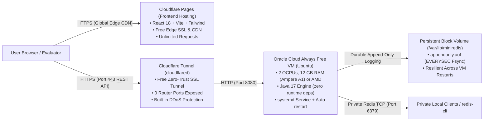

# MiniRedis v1.0.0: Free Cloud Hosting & Deployment Guide

This guide details how to host and run the complete **MiniRedis** production stack—including both the **React + Vite Live Management Dashboard** and the **Java 17 In-Memory Database Engine with persistent AOF storage**—at **strictly ₹0 ($0.00) ongoing infrastructure cost**.

---

## 1. Zero-Cost Architectural Overview



| Component | Platform | Resource Allocation | Cost |
| :--- | :--- | :--- | :--- |
| **Frontend Website & Dashboard** | **Cloudflare Pages** | Unlimited bandwidth, 500 builds/mo, global edge CDN | **₹0.00 / Free Forever** |
| **Java 17 Engine & Persistence** | **Oracle Cloud Always Free** | Up to 4 Ampere OCPUs, 24 GB RAM (or 1/8 OCPU AMD), 50–200 GB persistent storage | **₹0.00 / Free Forever** |
| **HTTPS Security & Encryption** | **Cloudflare Tunnel (`cloudflared`)** | TLS termination, automatic certificate generation, DDoS shield | **₹0.00 / Free Forever** |
| **Total Monthly Spend** | | | **₹0.00 (Zero)** |

---

## 2. Platform Comparison & Evaluation

| Evaluation Criteria | Cloudflare Pages + Oracle OCI | Render Free Tier | Fly.io Free Tier | Self-Hosted Tunnel (Local) |
| :--- | :--- | :--- | :--- | :--- |
| **Monthly Cost** | **₹0 (Strictly Free)** | ₹0 | Requires Credit Card | **₹0** |
| **Sleep / Spin-down** | **No Sleep (24/7 Always On)** | Sleeps after 15 min inactivity | Restarts / Sleep | **No Sleep (Always On)** |
| **Persistent Storage** | **Yes (50–200 GB Block Volume)** | **NO (Ephemeral disk loses AOF)** | 3 GB (Restricted) | **Yes (Local Disk)** |
| **Java 17 Compatibility**| **100% Native (OpenJDK 17)** | Supported (Memory constrained) | Supported | **100% Native** |
| **HTTPS Support** | **Automatic Edge SSL** | Automatic SSL | Automatic SSL | **Via Cloudflare Tunnel** |
| **TCP Port 6379 Security**| **Private (Shielded from Web)** | Public port not free | Complex routing | **Private to localhost** |

> [!IMPORTANT]
> **Why Render was rejected for backend persistence:**  
> Render's Free tier uses an ephemeral filesystem. Every time the instance spins down (after 15 minutes of inactivity) or deploys, all files on disk—including `appendonly.aof`—are deleted. MiniRedis requires persistent disk durability to guarantee ACID data recovery across restarts. Oracle Cloud Always Free provides true block volumes that never reset on reboot.

---

## 3. Step 1: Deploy Frontend on Cloudflare Pages (5 Minutes)

1. Log in to [Cloudflare Dashboard](https://dash.cloudflare.com/) (create a free account if you don't have one).
2. Navigate to **Workers & Pages** &rarr; **Create application** &rarr; **Pages** &rarr; **Connect to Git**.
3. Select the repository: `krishna18gupta/miniredis-java`.
4. Configure Build Settings:
   - **Framework preset**: `Vite`
   - **Root directory**: `website`
   - **Build command**: `npm run build`
   - **Build output directory**: `dist`
5. *(Optional)* Add Environment Variable:
   - Variable name: `VITE_API_BASE_URL`
   - Value: `https://api.yourdomain.com` (leave empty initially; you can change this at any time in the dashboard UI).
6. Click **Save and Deploy**. Cloudflare Pages will build and deploy the frontend in under 60 seconds with a free `*.pages.dev` domain and automatic SSL.

---

## 4. Step 2: Deploy Java Backend on Oracle Cloud Always Free

### A. Create Your Always Free Compute Instance
1. Sign in to your Oracle Cloud Console.
2. In the menu, go to **Compute** &rarr; **Instances** &rarr; **Create instance**.
3. Configure the instance:
   - **Name**: `miniredis-backend`
   - **Image**: `Ubuntu 22.04 LTS` or `Ubuntu 24.04 LTS` (Always Free Eligible).
   - **Shape**:
     - *Preferred:* `VM.Standard.A1.Flex` (Ampere ARM, 2 OCPUs, 12 GB RAM) – Always Free.
     - *Alternative:* `VM.Standard.E2.1.Micro` (AMD, 1 OCPU, 1 GB RAM) – Always Free.
   - **SSH Keys**: Download and save your private SSH key (`id_rsa`).
4. Click **Create** and wait for the instance status to show **Running**. Note the public IP address.

### B. Install OpenJDK 17 on the VM
SSH into the instance:
```bash
ssh -i /path/to/id_rsa ubuntu@YOUR_VM_PUBLIC_IP
```

Update system packages and install Java 17 JRE:
```bash
sudo apt update && sudo apt upgrade -y
sudo apt install -y openjdk-17-jre-headless curl
java -version
```

### C. Install and Configure MiniRedis
1. Create a dedicated system user and persistence directory:
```bash
sudo useradd -r -s /bin/false miniredis
sudo mkdir -p /opt/miniredis /var/lib/miniredis
sudo chown -R miniredis:miniredis /var/lib/miniredis
```

2. Download the official executable JAR:
```bash
sudo curl -L -o /opt/miniredis/miniredis-java-1.0.0.jar \
  https://github.com/krishna18gupta/miniredis-java/releases/download/v1.0.0/miniredis-java-1.0.0.jar
sudo chmod 755 /opt/miniredis/miniredis-java-1.0.0.jar
```

3. Install the systemd service unit:
```bash
sudo curl -L -o /etc/systemd/system/miniredis.service \
  https://raw.githubusercontent.com/krishna18gupta/miniredis-java/main/deploy/systemd/miniredis.service

sudo systemctl daemon-reload
sudo systemctl enable miniredis
sudo systemctl start miniredis
```

4. Verify backend status:
```bash
sudo systemctl status miniredis
curl -s http://localhost:8080/api/health
```
*Expected response:* `{"status":"UP","service":"MiniRedis","version":"1.0.0",...}`

---

## 5. Step 3: Zero-Cost Secure HTTPS via Cloudflare Tunnel

Cloudflare Tunnel exposes port 8080 to the public web via an outbound HTTPS tunnel. **No ports (not port 80, 443, or 6379) need to be opened in the Oracle Cloud Security List firewall.**

1. On the VM, install `cloudflared`:
```bash
curl -L --output cloudflared.deb https://github.com/cloudflare/cloudflared/releases/latest/download/cloudflared-linux-amd64.deb
sudo dpkg -i cloudflared.deb
```
*(For Ampere ARM64, download `cloudflared-linux-arm64.deb` instead).*

2. Authenticate `cloudflared`:
```bash
cloudflared tunnel login
```
*(Click the generated link in your browser to authorize your free Cloudflare account).*

3. Create the secure tunnel:
```bash
cloudflared tunnel create miniredis-backend
```

4. Configure the tunnel (`/etc/cloudflared/config.yml`):
```yaml
tunnel: YOUR_TUNNEL_UUID
credentials-file: /etc/cloudflared/YOUR_TUNNEL_UUID.json

ingress:
  - hostname: api.miniredis.yourdomain.com
    service: http://localhost:8080
  - service: http_status:404
```

5. Route DNS to your tunnel and run as a service:
```bash
cloudflared tunnel route dns miniredis-backend api.miniredis.yourdomain.com
sudo cloudflared service install
sudo systemctl start cloudflared
```

Your MiniRedis REST API and Web Console are now live at `https://api.miniredis.yourdomain.com` with full end-to-end HTTPS encryption, DDoS protection, and zero exposed ports!

---

## 6. Step 4: Connecting the Live Dashboard

1. Open your deployed Cloudflare Pages URL (e.g. `https://miniredis.pages.dev/dashboard`).
2. If the status shows "Database Offline", click **Connection Settings** on the dashboard banner.
3. Enter your backend URL: `https://api.miniredis.yourdomain.com`.
4. Click **Apply & Reconnect**.
5. The live metrics, keyspace table, throughput graphs, and command terminal will immediately stream real data from your Java engine!

---

## 7. Persistence, Recovery & Backup Verification

### Verifying Crash Resilience
Test that data survives process restarts:
1. In the Web Console or CLI, execute:
   ```redis
   SET production:test "DurableData123"
   ```
2. On the server, restart the systemd service:
   ```bash
   sudo systemctl restart miniredis
   ```
3. Check the service logs to verify AOF replay:
   ```bash
   sudo journalctl -u miniredis -n 20 --no-pager
   ```
   *Output shows:* `>> AOF Recovery: Successfully replayed 1 commands from /var/lib/miniredis/appendonly.aof <<`
4. Query the key:
   ```bash
   curl -s "http://localhost:8080/api/keys?key=production:test"
   ```
   The data is intact!

### Daily Automated Backup (Cron)
Add a zero-cost daily backup cron job:
```bash
sudo crontab -e
```
Add the following line to back up the AOF file every night at 2:00 AM:
```cron
0 2 * * * cp /var/lib/miniredis/appendonly.aof /var/lib/miniredis/backup-$(date +\%F).aof
```

---

## 8. Summary of Cost & Budget Verification

- **Compute**: ₹0 (Oracle Always Free Ampere A1 or AMD Compute)
- **Persistent Disk**: ₹0 (Part of 200 GB Always Free block storage)
- **Frontend Hosting**: ₹0 (Cloudflare Pages unlimited free tier)
- **SSL / TLS**: ₹0 (Cloudflare automatic edge certificates)
- **DDoS Protection**: ₹0 (Cloudflare unmetered DDoS mitigation)
- **Bandwidth**: ₹0 (10 TB/month free on Oracle Cloud; unlimited on Cloudflare)
- **Total Ongoing Cost**: **₹0.00**
